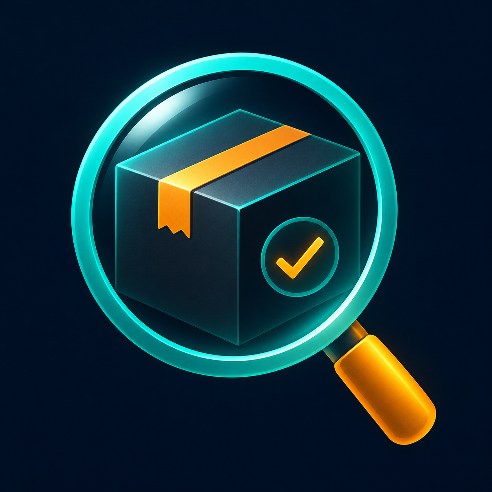
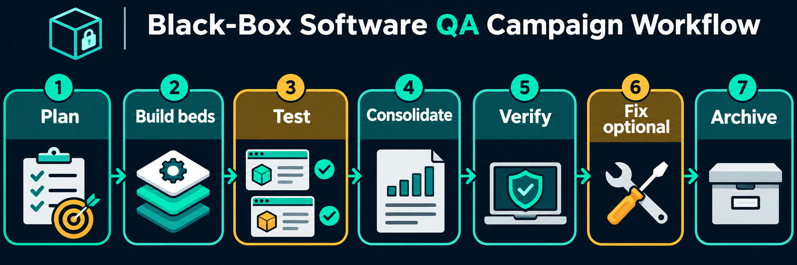
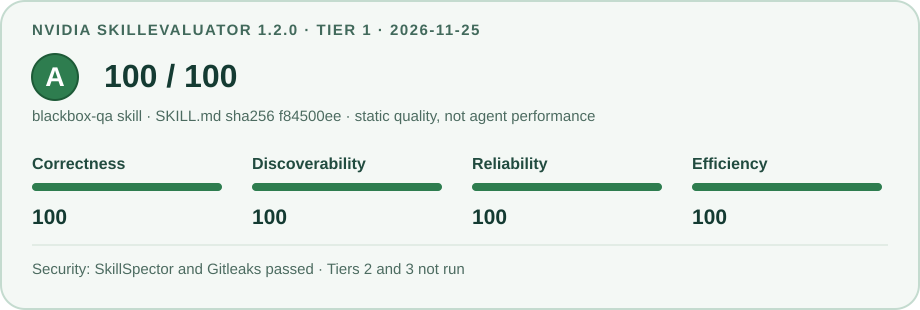

<p align="center"></p>

# Black-box QA

[](LICENSE)

An [Agent Skill](https://agentskills.io) for planning and running a multi-agent black-box QA campaign against a built server, CLI, or library using real example projects. It organizes checks, bug reports, independent verification, and optional fixes.

## How it works



A planning agent creates area checklists; testers run them against reproducible test beds. Reports are deduplicated and independently verified before any requested fixes. The workspace keeps the checks, reports, drivers, and scripts needed to reproduce the campaign.

The skill also codifies a set of **context-economy practices** learned from a full campaign: campaign documents are indexes with one file per bug or fix block, every agent gets a self-contained brief instead of "read the whole doc", bugs are verified in batches rather than one agent each, evidence stays on disk and is referenced by path, and a short resume doc carries state across pauses. These exist because agents re-reading large campaign documents was the biggest resource cost of the reference campaign.

## Quick start

```bash
npx skills add illescasDaniel/blackbox-qa-skill
```

Ask your agent to “QA this CLI on real projects” or “verify the reported bugs.” The skills CLI can install the skill for a supported agent and scope you select.

<details>
<summary>Manual installation</summary>

Copy `skills/blackbox-qa/` into the skills directory for your agent, for example `.claude/skills/blackbox-qa/` for a Claude Code project or `~/.agents/skills/blackbox-qa/` for Codex globally.

</details>

## Requirements and limits

The workflow assumes an agent environment able to delegate to subagents, with access to the tool and suitable example projects. Its model defaults name Claude model tiers; availability, cost, and delegation capabilities depend on the host. Parallel fixes also require git worktrees. Campaigns can be resource-intensive. Fixes are optional and require a user request; intended-behavior decisions go to the user.

## Evaluation



NVIDIA SkillEvaluator 1.2.0 scored the skill **A, 100/100** on its static quality checks on 2026-11-25. SkillSpector and Gitleaks checks passed; these static checks are not a complete security assessment. See [evaluation details](docs/evaluation.md).

## Field use

The full workflow has been exercised end-to-end once, in a multi-agent campaign against a real MCP server: hundreds of black-box checks across 23 areas, batched verification of every reported bug, and parallel fix blocks in isolated worktrees, followed by a complete re-run on the release tree. The context-economy section reflects what that campaign taught; later revisions are not field-tested yet.

## Contributing

Issues and pull requests are welcome. Keep the skill focused and its instructions concise.

## License

MIT, see [LICENSE](LICENSE).
